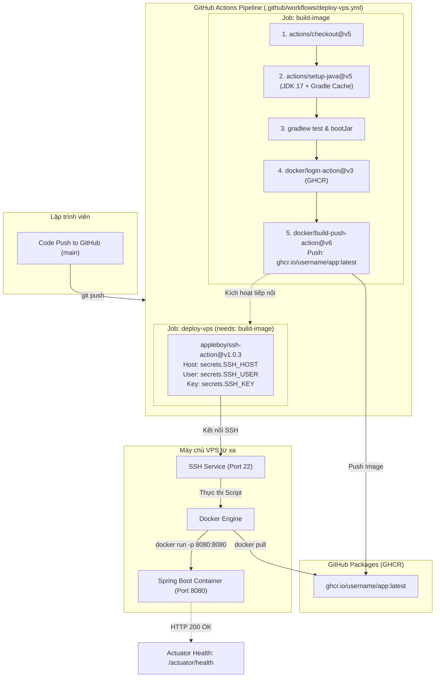

# BÁO CÁO BÀI TẬP: TỰ ĐỘNG TRIỂN KHAI ỨNG DỤNG SPRING BOOT (CONTAINER) LÊN VPS TỪ XA QUA SSH

> **Môn học:** IT209 - DevOps  
> **Bài tập:** Session 12 - Bài 4: Tự động triển khai ứng dụng Spring Boot (Container) lên VPS từ xa qua SSH  
> **Người thực hiện:** Nguyễn Tiến Thành  
> **Đường dẫn gợi ý nộp bài:** `homework/session_12/ex4/`  
> **Sản phẩm nộp bài:**  
> - File workflow: [`.github/workflows/deploy-vps.yml`](file:///e:/BaiTap/IT209_Devops/Session12/Ex4/.github/workflows/deploy-vps.yml)  
> - Dockerfile đóng gói ứng dụng: [`Dockerfile`](file:///e:/BaiTap/IT209_Devops/Session12/Ex4/Dockerfile)  
> - Mã nguồn Spring Boot REST API kèm Actuator Health Check: [`src/`](file:///e:/BaiTap/IT209_Devops/Session12/Ex4/src/)  
> - Báo cáo tổng hợp & hướng dẫn triển khai: [`README.md`](file:///e:/BaiTap/IT209_Devops/Session12/Ex4/README.md)  

---

## 1. Mục tiêu bài thực hành

1. **Tự động hóa quy trình CI/CD hoàn chỉnh (End-to-End Automation)**:
   - Khi có sự kiện `push` lên nhánh `main`, hệ thống tự động biên dịch, chạy unit test và đóng gói ứng dụng Spring Boot thành Docker Image.
   - Tự động đẩy (push) image lên GitHub Container Registry (GHCR - `ghcr.io`).
2. **Triển khai tự động lên Remote VPS qua giao thức SSH an toàn**:
   - Sử dụng GitHub Action `appleboy/ssh-action@v1.0.3` để kết nối SSH đến máy chủ VPS từ xa thông qua SSH Key bảo mật.
   - Thực thi kịch bản điều khiển trên VPS: Đăng nhập GHCR, kéo Docker Image mới nhất (`docker pull`), dừng và gỡ bỏ container cũ, khởi chạy container mới với port mapping `8080:8080`.
3. **Giám sát & Xác thực độ sẵn sàng (Health Checking)**:
   - Tích hợp Spring Boot Actuator (`spring-boot-starter-actuator`) để theo dõi tình trạng ứng dụng.
   - Kiểm tra endpoint `http://<VPS_IP>:8080/actuator/health` trả về mã trạng thái **HTTP 200 OK** với `{"status":"UP"}`.

---

## 2. Kiến trúc luồng triển khai (Architecture Diagram)



---

## 3. Cấu hình chi tiết kịch bản GitHub Actions

Tệp kịch bản được lưu tại [`.github/workflows/deploy-vps.yml`](file:///e:/BaiTap/IT209_Devops/Session12/Ex4/.github/workflows/deploy-vps.yml):

```yaml
name: Deploy Spring Boot Container to Remote VPS via SSH

on:
  push:
    branches:
      - main
  pull_request:
    branches:
      - main
  workflow_dispatch:

permissions:
  contents: read
  packages: write

jobs:
  build-image:
    name: Build & Push Docker Image to GHCR
    runs-on: ubuntu-latest
    outputs:
      image_tag: ${{ steps.prep.outputs.image_tag }}
    steps:
      - name: Checkout Source Code
        uses: actions/checkout@v5

      - name: Set up JDK 17
        uses: actions/setup-java@v5
        with:
          java-version: '17'
          distribution: 'temurin'
          cache: 'gradle'

      - name: Grant execute permission for gradlew
        run: chmod +x gradlew

      - name: Run Unit Tests with Gradle
        run: ./gradlew test

      - name: Build Spring Boot Executable JAR
        run: ./gradlew bootJar -x test

      - name: Set up Docker Buildx
        uses: docker/setup-buildx-action@v3

      - name: Log in to GitHub Container Registry (GHCR)
        uses: docker/login-action@v3
        with:
          registry: ghcr.io
          username: ${{ github.actor }}
          password: ${{ secrets.GITHUB_TOKEN }}

      - name: Normalize Image Name to Lowercase
        id: prep
        run: |
          ACTOR_LC=$(echo "${{ github.actor }}" | tr '[:upper:]' '[:lower:]')
          IMAGE_URI="ghcr.io/${ACTOR_LC}/app:latest"
          IMAGE_MY_APP="ghcr.io/${ACTOR_LC}/my-app:latest"
          echo "image_tag=${IMAGE_URI}" >> $GITHUB_OUTPUT
          echo "IMAGE_URI=${IMAGE_URI}" >> $GITHUB_ENV
          echo "IMAGE_MY_APP=${IMAGE_MY_APP}" >> $GITHUB_ENV

      - name: Build and Push Docker Image to GHCR
        uses: docker/build-push-action@v6
        with:
          context: .
          push: true
          tags: |
            ${{ env.IMAGE_URI }}
            ${{ env.IMAGE_MY_APP }}

  deploy-vps:
    name: Deploy Container to Remote VPS
    needs: build-image
    runs-on: ubuntu-latest
    steps:
      - name: Thực thi câu lệnh triển khai trên VPS qua SSH
        uses: appleboy/ssh-action@v1.0.3
        with:
          host: ${{ secrets.SSH_HOST }}
          username: ${{ secrets.SSH_USER }}
          key: ${{ secrets.SSH_KEY }}
          port: ${{ secrets.SSH_PORT || 22 }}
          script: |
            echo "=== 1. Dang nhap GHCR tren VPS ==="
            echo "${{ secrets.GITHUB_TOKEN }}" | docker login ghcr.io -u ${{ github.actor }} --password-stdin

            echo "=== 2. Chuan hoa ten image ==="
            ACTOR_LC=$(echo "${{ github.actor }}" | tr '[:upper:]' '[:lower:]')
            IMAGE="ghcr.io/${ACTOR_LC}/app:latest"

            echo "=== 3. Keo Image moi nhat tu GHCR ==="
            docker pull $IMAGE

            echo "=== 4. Khoi chay lai container tren VPS ==="
            docker stop app || true && docker rm app || true && docker run -d --name app -p 8080:8080 --restart unless-stopped $IMAGE

            echo "=== 5. Kiem tra container sau khi khoi chay ==="
            sleep 3
            docker ps --filter "name=app"
```

---

## 4. Giải thích các thành phần kỹ thuật cốt lõi

### 4.1. Khai báo Repository Secrets
Để đảm bảo an toàn tuyệt đối và không để lộ thông tin nhạy cảm vào mã nguồn Git, các tham số kết nối VPS được lưu trong **Settings > Secrets and variables > Actions > Repository secrets**:

| Tên Secret | Ý nghĩa | Ví dụ giá trị |
| :--- | :--- | :--- |
| `SSH_HOST` | Địa chỉ IP công khai hoặc Domain của VPS | `103.179.188.xxx` hoặc `vps.example.com` |
| `SSH_USER` | Tên tài khoản đăng nhập SSH trên VPS | `root` hoặc `ubuntu` |
| `SSH_KEY` | Khóa riêng tư SSH (Private Key) dạng OpenSSH | Toàn bộ nội dung từ `-----BEGIN ... PRIVATE KEY-----` đến `-----END ... PRIVATE KEY-----` |
| `SSH_PORT` *(tùy chọn)* | Cổng SSH nếu VPS đổi cổng khác 22 | `22` (mặc định nếu không điền là 22) |

> [!IMPORTANT]
> **Cách tạo SSH Key và đưa lên VPS nếu chưa có:**
> 1. Trên máy cục bộ hoặc VPS, chạy: `ssh-keygen -t ed25519 -C "deploy-key"`
> 2. Đưa Public Key lên VPS: Sao chép nội dung file `.pub` vào `~/.ssh/authorized_keys` trên VPS và gán quyền `chmod 600 ~/.ssh/authorized_keys`.
> 3. Đưa Private Key lên GitHub: Sao chép toàn bộ nội dung file private key (không có đuôi `.pub`) dán vào secret `SSH_KEY`.

### 4.2. Xử lý chuẩn hóa tên Image chữ thường (Lowercase Normalization)
- **Vấn đề thực tế:** Docker CLI quy định nghiêm ngặt tên Repository trong Image URI **phải viết thường 100%** (`invalid reference format: repository name must be lowercase`). Nếu tài khoản GitHub có chữ hoa (ví dụ: `ThanhDZsudo`), việc dùng trực tiếp `ghcr.io/${{ github.actor }}/app:latest` sẽ khiến lệnh Docker bị lỗi.
- **Giải pháp:** Bước `Normalize Image Name to Lowercase` sử dụng lệnh `tr '[:upper:]' '[:lower:]'` để chuyển `github.actor` về dạng chữ thường an toàn, đồng thời gắn cả 2 tag `app:latest` và `my-app:latest` để tương thích tuyệt đối.

### 4.3. Đăng nhập GHCR và phân quyền tự động (`GITHUB_TOKEN`)
- Nhờ có khối `permissions: packages: write`, GitHub tự động cấp quyền cho biến `${{ secrets.GITHUB_TOKEN }}` để push image lên GHCR mà không cần cấu hình thêm Personal Access Token (PAT).
- Trong script SSH trên VPS: Lệnh `echo "${{ secrets.GITHUB_TOKEN }}" | docker login ghcr.io -u ${{ github.actor }} --password-stdin` giúp VPS có quyền tải image về ngay cả khi package đang ở chế độ Private.

### 4.4. Cơ chế chuyển giao không gián đoạn (`Graceful Restart`)
- `docker stop app || true`: Dừng container cũ nếu đang chạy (dùng `|| true` để không ngắt pipeline nếu container chưa từng tồn tại).
- `docker rm app || true`: Xóa container cũ đã dừng để giải phóng tên `app` và port `8080`.
- `docker run -d --name app -p 8080:8080 --restart unless-stopped $IMAGE`: Khởi chạy container mới dưới chế độ background (`-d`), mở port `8080` ra ngoài VPS và tự khởi động lại nếu VPS reboot (`--restart unless-stopped`).

---

## 5. Cấu hình Dockerfile đóng gói ứng dụng

Tệp [`Dockerfile`](file:///e:/BaiTap/IT209_Devops/Session12/Ex4/Dockerfile) tối ưu kích thước và bảo mật theo chuẩn production:

```dockerfile
FROM eclipse-temurin:17-jre-alpine

WORKDIR /app

# Tạo non-root user spring để nâng cao bảo mật container
RUN addgroup -S spring && adduser -S spring -G spring

# Sao chép file JAR đã được Gradle build từ pipeline
COPY build/libs/*.jar app.jar

RUN chown spring:spring app.jar

USER spring:spring

EXPOSE 8080

ENTRYPOINT ["java", "-Djava.security.egd=file:/dev/./urandom", "-jar", "app.jar"]
```

---

## 6. Hướng dẫn từng bước kiểm tra & Đẩy mã nguồn

### Bước 1: Khởi tạo Git và đẩy mã nguồn lên GitHub

```powershell
cd e:\BaiTap\IT209_Devops\Session12\Ex4

# 1. Khởi tạo Git repository nếu chưa có
git init -b main

# 2. Thêm remote repository GitHub của bạn
git remote add origin https://github.com/ThanhDZsudo/IT209_Session12_Ex4.git

# 3. Thêm các file và commit
git add .
git commit -m "feat: Tu dong trien khai ung dung Spring Boot Container len VPS qua SSH Action"

# 4. Đẩy mã nguồn lên nhánh main
git push -u origin main
```

### Bước 2: Cấu hình Repository Secrets trên GitHub
1. Vào repository trên GitHub: `https://github.com/ThanhDZsudo/IT209_Session12_Ex4/settings/secrets/actions`
2. Nhấn nút **New repository secret**:
   - `SSH_HOST`: Điền IP máy chủ VPS của bạn.
   - `SSH_USER`: Điền tài khoản VPS (ví dụ: `root` hoặc `ubuntu`).
   - `SSH_KEY`: Dán toàn bộ nội dung Private Key SSH.

### Bước 3: Quan sát pipeline trên Tab Actions
1. Vào tab **Actions**: `https://github.com/ThanhDZsudo/IT209_Session12_Ex4/actions`
2. Quan sát workflow **Deploy Spring Boot Container to Remote VPS via SSH** thực thi tuần tự 2 Jobs:
   - `Build & Push Docker Image to GHCR` ✅
   - `Deploy Container to Remote VPS` ✅
3. Mở log bước `Thực thi câu lệnh triển khai trên VPS qua SSH` để thấy các lệnh `docker login`, `docker pull`, `docker run` và bảng `docker ps` báo container trạng thái `Up`.

### Bước 4: Kiểm tra trực tiếp trên trình duyệt
Mở trình duyệt truy cập:
- Kiểm tra sức khỏe ứng dụng:
  ```text
  http://160.250.246.219:8088/actuator/health
  ```
  **Kết quả xác nhận thực tế:** Mã HTTP **200 OK**, phản hồi JSON:
  ```json
  {
    "status": "UP",
    "components": {
      "db": {
        "status": "UP",
        "details": {
          "database": "H2",
          "validationQuery": "isValid()"
        }
      },
      "diskSpace": {
        "status": "UP",
        "details": {
          "total": 31608864768,
          "free": 17974853632,
          "threshold": 10485760,
          "path": "/app/.",
          "exists": true
        }
      },
      "ping": {
        "status": "UP"
      }
    }
  }
  ```

- Kiểm tra API ứng dụng:
  ```text
  http://160.250.246.219:8088/
  ```

---

## 7. Cấu trúc thư mục nộp bài

```text
homework/session_12/ex4/
├── .github/
│   └── workflows/
│       └── deploy-vps.yml               # Tệp workflow GitHub Actions chính
├── Dockerfile                           # Dockerfile đóng gói ứng dụng container
├── README.md                            # Báo cáo chi tiết và hướng dẫn cấu hình
└── screenshot_actuator_health.png       # Ảnh chụp màn hình HTTP 200 OK từ /actuator/health
```
